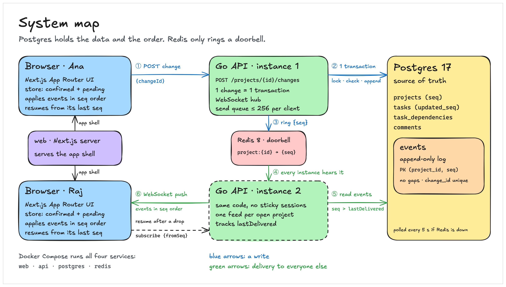
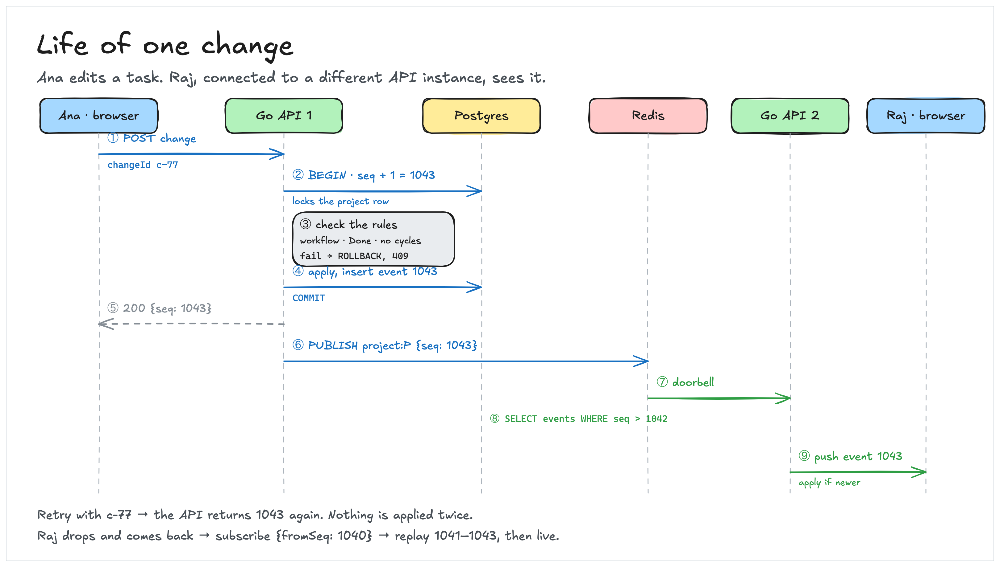

# Collab Tasks

[](https://github.com/tjonty/collab-tasks/actions/workflows/ci.yml)

A real-time collaborative task manager: projects, tasks with dependencies and a status workflow, and comment threads. Every open tab sees each change within a second. A Go API and a Next.js web app, backed by Postgres and Redis, with no managed real-time database.

**Where the brief's write-up lives:**

| The brief asks for | Section |
| ------------------ | ------- |
| Architecture decisions | [Architecture](#architecture), [Decisions and tradeoffs](#decisions-and-tradeoffs) |
| How you handle sync | [Data flow and synchronization](#data-flow-and-synchronization) |
| How you'd scale the system over time | [Scaling](#scaling) |
| Tradeoffs | [Decisions and tradeoffs](#decisions-and-tradeoffs) |
| Technology choices and justifications | [Technology choices](#technology-choices) |
| Data flow and synchronization strategy | [Data flow and synchronization](#data-flow-and-synchronization) |
| Assumptions | [Assumptions](#assumptions) |
| Extended challenges | [Extended challenges](#extended-challenges) |

## Quick start

### Prerequisites

- Docker with Compose v2 or later.
- For local development only: Go 1.27 and Node 24.

### Run everything

```sh
docker compose up --build
```

This starts Postgres, Redis, the API and the web app. Then open:

- Web: http://localhost:3000. Pick a display name, then create or open a project. Each browser tab can be a different person. The System / Light / Dark switch in the header sets the theme for the whole browser.
- API: http://localhost:8080/healthz. It returns `{"postgres":"ok","redis":"ok"}` with 200, or 503 if either dependency is down.
- API docs: http://localhost:8080/docs, a browsable page for the contract (the raw spec is at `/openapi.json`).

### Seed a demo project

With the stack running, create a project of 10,000 tasks, with dependencies, comments and every status, through the same write pipeline the API uses. It takes about 30 seconds and prints a link to the project:

```sh
docker compose exec api /seed
```

Flags: `-tasks`, `-comments` and `-random-seed` (the same seed plans the same project).

### Local development

Keep Postgres and Redis in Docker, and run the API and web app on your machine with hot reload:

```sh
docker compose up -d postgres redis   # if they are not already running
docker compose stop api web           # free ports 8080 and 3000
```

Then, in two terminals:

```sh
cd api && go run ./cmd/server
```

```sh
cd web && npm install && npm run dev
```

When you're done, stop both with Ctrl-C and bring the containers back:

```sh
docker compose start api web
```

The API reads `PORT`, `DATABASE_URL`, `REDIS_URL` and `CORS_ORIGIN`. Their defaults match the Docker setup, so no `.env` file is needed. The web app's API URL comes from `NEXT_PUBLIC_API_URL`, default `http://localhost:8080`. That value is built into the bundle, so changing it means rebuilding (`docker compose build web`).

### Ports

| Port | Service    |
| ---- | ---------- |
| 3000 | Web app    |
| 8080 | API        |
| 5432 | Postgres   |
| 6379 | Redis      |

## Try it

1. Open http://localhost:3000 in two windows side by side. Each tab is its own person, so pick two names. Create a project in one window and open the same URL in the other.
2. Add tasks, comment, link dependencies and change statuses. Each change shows up in the other window within a second.
3. Try to mark a task Done while one of its dependencies is open. Done is disabled, and the drawer says what it's waiting on.
4. Run `docker compose stop redis`. Changes still arrive, within about 5 seconds. Bring it back with `docker compose start redis`.
5. Take one window offline (DevTools → Network → Offline), make edits in the other, then go back online. The offline window catches up.
6. Seed a demo project and scroll through its 10,000 tasks.
7. Read the event log. Every edit is a small event that carries only what changed. Reads need a user id, which `POST /users` returns:

   ```sh
   curl -s localhost:8080/users -H 'Content-Type: application/json' -d '{"displayName":"curl"}'
   curl -s 'localhost:8080/projects/<project-id>/events?after=0&limit=5' -H 'X-User-Id: <id from above>'
   ```

   The project id is in the page URL.

## Architecture

Four services run in Docker Compose. Every write goes through one endpoint and one Postgres transaction, and every live update comes from the per-project event log.



Blue arrows are a write. Green arrows are how everyone else hears about it.

| Component | What it is | Responsibility |
| --------- | ---------- | -------------- |
| Browser | The Next.js app, with its sync store in `web/src/lib/sync` | Keeps confirmed data apart from pending edits, applies events in `seq` order, and resumes from its last `seq` |
| web | The Next.js standalone server | Serves only the app shell; the browser talks to the API directly |
| API | Go, one instance or many | Serves `POST /projects/{id}/changes`, the reads, and `GET /ws` |
| Postgres 17 | The source of truth | Holds projects, tasks, dependencies, comments, and the append-only `events` log keyed by `(project_id, seq)` |
| Redis 8 | Only the doorbell: `{projectId, seq}` on `project:{id}` | If it's down, updates arrive within 5 s through the poll, and no data is lost |

## Data flow and synchronization



The life of one change, from Ana's edit to Raj's screen:

1. Ana's browser sends `POST /projects/{id}/changes` with `{changeId, change}`.
2. In one transaction, `UPDATE projects SET seq = seq + 1` locks the project and takes the next number, 1043.
3. The API checks the rules against the current state. A broken rule rolls back with 409, and 1043 is never used.
4. It applies the change, inserts event 1043, and commits.
5. It answers `200 {"seq": 1043}`.
6. It publishes `{projectId, seq: 1043}` on `project:{id}`. The publish is queued at the commit and sent in the background, so a slow Redis never delays the answer.
7. Every API instance hears it, and those with viewers of the project act on it.
8. Each of those instances reads the missing events from Postgres, in order (`seq > lastDelivered`).
9. Raj's tab gets event 1043 over its WebSocket and applies it only if 1043 is newer than the task's `updatedSeq`.

**One ordered log per project.**
- Every write is a typed change, such as `task.setStatus`, `task.addDependency` or `comment.create`; there are 12 types. It's sent to `POST /projects/{id}/changes`.
- Each change runs in one Postgres transaction that:
  1. locks the project row and takes its next sequence number (`seq`)
  2. checks the rules against the latest state
  3. applies the change
  4. appends one event to the log
- A rejected change rolls back, so `seq` has no gaps. A client that sees a jump knows it missed something and asks again.
- Each change carries a client-generated `changeId`. Retrying it returns the original `seq` instead of applying it twice.

**Doorbell and pull.**
- After a commit, the API publishes a tiny `{projectId, seq}` on Redis. Every API instance listens.
- For each project that has viewers, the instance reads the new events from Postgres, in order, and pushes them over the WebSocket.
- Postgres is the only source of order, so a lost or duplicated doorbell does no harm. A 5-second poll catches anything a doorbell missed, including while Redis is down.
- There is no managed real-time database: Postgres holds the state and the log, Redis carries only doorbells, and the WebSocket server is our own.

**Catching up.**
- A tab subscribes from the last `seq` it has. The server replays everything after it, then streams live events, with no gaps and no duplicates.
- After a dropped connection, the tab resubscribes the same way.
- A tab more than 5,000 events behind reloads the project instead.

**Slow and silent clients.**
- A connection whose 256-message send queue fills, or whose write stalls for 5 s, is closed with code 4008. The tab reconnects and replays what it missed.
- The server pings every 20 s and drops a connection that doesn't answer within 10 s.

**Large projects (2 MB+).** Nothing ever resends a whole project.
- Opening a project loads compact task summaries in the background while the first page renders. A summary is about 250 bytes, and a page of 500 is about 20 KB gzipped.
- Descriptions, custom fields and comments load when a task is opened.
- An edit travels as one event that carries only what changed. A test builds a task over 10 KB and checks that every kind of edit to it is a single event under 1 KB.
- Filtering, sorting and Blocked are computed in the browser, and the list is virtualized.

**Merging.**
- Every task records the `seq` of its last change, and every event lists the tasks it touched.
- An event applies to a task only if it's newer, so pages and events can arrive in any order and still end up the same. A randomized test checks this.
- Deleted tasks are remembered for the session, so a page fetched before the delete can't bring one back.

## Technology choices

| Choice | Why | Instead of |
| ------ | --- | ---------- |
| Go, standard `net/http` | Goroutines suit long-lived WebSockets and per-project fan-out, and it ships as one small binary. | Next.js route handlers, which handle long-lived WebSockets badly. |
| Next.js 16 App Router, React 19 | The brief's preferred stack: routes, layouts and loading and error boundaries come from the App Router, and live data lives in client components. | Vite with React. |
| Postgres 17 | One transaction and a row lock per project give one order and safe rule checks, and the state commits together with its event. | A separate log such as Kafka, which needs a dual write or an outbox. |
| Redis 8, pub/sub only | Tiny notices reach every API instance, and it's optional because of the 5 s poll. | Full events over Redis, which needs reordering and gap-filling in every instance. |
| WebSocket (`coder/websocket`) | One connection carries subscribe, resume and pushes. | Server-sent events, which need a second channel for subscribe and resume. |
| OpenAPI 3.1, oapi-codegen, openapi-typescript | One contract generates the Go and TypeScript types, CI fails on drift, and Swagger is at `/docs`. | Hand-written types on both sides. |
| pgx, sqlc, goose | Typed SQL with no ORM, and migrations embedded and applied at start. | An ORM, which hides the locking this design depends on. |
| TanStack Virtual, TanStack Query | About 40 of 10,000 rows are mounted, with simple caching for the lists. | Rendering every row. |
| testcontainers, Vitest, Playwright, k6 | Tests run against real Postgres and Redis, there's a two-browser end-to-end test, and the load tests have recorded results. | Mocks of the database. |

## Decisions and tradeoffs

- **Simultaneous edits:**
  - The last write wins, per field, in the server's order. Custom fields merge per key.
  - Assignees, tags and dependencies are added or removed one at a time, so two people adding different items both succeed.
  - Status changes are never overwritten blindly. Each one is checked against the current status and can be rejected, with a message saying why.
- **Known tradeoff:** if two people save the same description at the same moment, the later save replaces the whole text. There is no character-level merging.
- **Dependencies:**
  - Work can start any time, but a task can become Done only when all its dependencies are Done.
  - Cycles are rejected. The check runs under the project lock, so two opposite links racing can't both succeed.
  - Blocked is computed, never stored. Reopening a dependency doesn't undo Done.
- **Server components render only the static shell.** Project data lives in client components backed by the sync store. Anything rendered on the server would be stale a moment later, and the live stream has to start from a known `seq` anyway.
- **Saving, not optimistic updates:** a changed field shows "saving…" until its event comes back.
- **Failed saves:** a save that fails on the network retries with the same `changeId`, then offers Retry or Discard.
- **A server-ordered log instead of CRDTs:**
  - Rules like "no dependency cycles" need a referee: two edits that are each valid on their own could merge into a cycle. The cost is no offline editing.
  - The per-field merge above is the CRDT-inspired part, with the server as the referee.
- **One lock per project:** one order and safe rule checks. The cost is a cap on one project's write rate: 482.7 changes/s on one project vs 899.1/s over 20 projects ([write throughput](docs/performance.md#write-throughput)).
- **Doorbell and pull, not full events over Redis:** Postgres stays the only source of order. The cost is one small indexed read per event for each instance with viewers, and up to 5 s of delay while Redis is down.
- **Every task summary loaded, heavy fields on demand:** filtering, sorting and Blocked work in the browser with no round trip. The cost is that opening a project takes longer as it grows, p95 502.0 ms at 10,000 tasks; much larger projects would filter on the server.
- **Client-generated UUIDv7 ids:** a retried create can't make a duplicate, and ids double as a time-ordered cursor. The cost is that the server trusts client ids, checking only their format and uniqueness.

## Assumptions

Where the brief leaves room, the design assumes:

- **Scale:** about 10,000 tasks per project, a handful of people editing a project at once, one region and one database. The load tests use a project of this size.
- **Online editing:** a tab must be online to edit. An offline tab catches up when it reconnects.
- **Workflow:** To do → In progress; In progress → To do, In review or Done; In review → In progress or Done; Done → In progress.
- **Dependencies:** work can start at any time, but a task can become Done only when every dependency is Done. Reopening a dependency doesn't reopen tasks that are already Done.
- **Descriptions:** the last save wins the whole text.
- **Ordering:** per project only. There's no order across projects.
- **Timestamps:** comment and event times come from the server. Client clocks only shape new task ids, which sort tasks by when they were created.
- **Identity and deletes:** see [Not included and next steps](#not-included-and-next-steps).

## Scaling

- Run more API instances behind a load balancer. No sticky sessions are needed: every instance hears every doorbell and reads from the same Postgres.
- As instances multiply, move from each one subscribing to every project (`PSUBSCRIBE project:*`) to per-project subscriptions or NATS subjects, so an instance only hears about the projects its clients have open.
- Serve the event reads from a Postgres read replica.
- **First limit, measured on one API instance on a laptop:** the project lock, at 482.7 changes/s on one project vs 899.1/s over 20 projects.
- **Shard by project:** projects never interact, so each can live on its own Postgres database, chosen from the project id. Only the small users table is shared.
- **Event-log growth:** partition `events` by project, and snapshot and archive old events. Tabs more than 5,000 events behind already reload instead of replaying, so old events matter only for audit.
- **Very large projects:** for projects far beyond 10,000 tasks, filter and sort on the server and load only what's on screen.
- **Connections:** each API instance holds its own WebSockets, so more instances hold more connections, and the doorbell reaches them all.

## Extended challenges

The brief asks for at least one extended challenge. This project takes on two.

**Option 3, Developer Experience:**
- **Tests:** unit tests, integration tests against real Postgres and Redis (testcontainers), and end-to-end tests with two people in two browsers. See [Tests](#tests).
- **CI/CD:** [`.github/workflows/ci.yml`](.github/workflows/ci.yml) runs on every push and pull request:
  - `go`: format check, generated code up to date, `go vet`, and every Go test with the race detector
  - `web`: generated API types up to date, lint, typecheck, unit tests, and a production build
  - `e2e`: the whole stack in Docker, a seed smoke test, and the Playwright tests
  - `publish`: on `main`, pushes the API and web images to GHCR. They're built for running locally: the web image calls the API at `http://localhost:8080`.
- **API documentation:** the OpenAPI 3.1 contract, [`contract/openapi.yaml`](contract/openapi.yaml), generates the Go server types and the TypeScript types. The API serves it at `/openapi.json`, and http://localhost:8080/docs is a Swagger page for browsing and trying it.
- **Migrations and seeding:** goose migrations run when the API starts, and `docker compose exec api /seed` creates a 10,000-task demo project through the real write pipeline.

**Option 1, Performance & Scale:**
- **Virtual scrolling:** TanStack Virtual mounts only the rows on screen plus a few either side, about 40 of the 10,000.
- **Cursor pagination:** task pages and the event log use keyset paging (`id > cursor`, `seq > n`), never `OFFSET`.
- **Index strategy and load tests:** [docs/performance.md](docs/performance.md). Every hot query is served by an index. Headlines, from one API instance on a laptop:
  - **Writes:** 482.7 changes a second on one project, and 899.1 spread over 20 projects.
  - **Real time:** 200 listeners got 89,400 deliveries with no gaps, and delivery p95 was 89.0 ms. The recorded run missed its p99 target; the write-up explains why.
  - **Opening the 10,000-task project:** p95 502.0 ms, with 393,233 bytes on the wire instead of 2,586,735.

## Tests

```sh
cd api && go test ./...      # unit and integration tests (Docker must be running; -short skips the Docker ones)
cd web && npm test           # Vitest: the sync engine, the task rules and the UI components
cd web && npm run test:e2e   # Playwright: two people in two browsers, and the theme switch, against the running stack
```

`npm run test:e2e:demo` runs the end-to-end test in visible, slowed-down browsers and records a video of each in `web/test-results/`. It doubles as the demo script.

CI runs all of these on every push and pull request, and also checks that the generated code is up to date ([`.github/workflows/ci.yml`](.github/workflows/ci.yml)).

The load tests use [k6](https://k6.io) against the running stack. [docs/performance.md](docs/performance.md) has their results, the index strategy, and how to rerun everything:

```sh
k6 run loadtest/writes.js                            # write throughput: one project vs 20
k6 run loadtest/fanout.js                            # 200 people watching one project (macOS: ulimit -n 4096 first)
k6 run -e PROJECT_ID=<id> loadtest/initial-load.js   # opening a seeded 10,000-task project
```

## Not included and next steps

- **Identity is not secure.** There's no login. Picking a display name creates a user, and the API trusts the `X-User-Id` header (`?userId=` on the WebSocket). Anyone who knows a user's id can act as that user. That's a demo shortcut, not something to ship.
- **No deleting projects, comments or users.** The brief doesn't ask for it. Deleting a task deletes its comments and its dependency links too. Comments can't be edited.

**Next steps:**
- Optimistic updates: the store already keeps pending edits separate.
- AI task suggestions: break a task into subtasks that sync live and obey the Done rule.
- Rate limiting on writes.
- Presence: who else is looking at a project.
- Character-level merging for descriptions.
- Real sign-in.

## Code map

| Path | What's there |
| ---- | ------------ |
| `contract/openapi.yaml` | The API contract, including the WebSocket messages. The Go server types and the TypeScript types are generated from it. The API serves it at `/openapi.json`, browsable at `/docs`. |
| `api/internal/domain` | The status workflow, the Done rule and field limits, in pure Go |
| `api/internal/changes` | The write pipeline: one change, one transaction, one event |
| `api/internal/httpapi` | The HTTP handlers, plus identity, CORS and gzip |
| `api/internal/realtime` | The WebSocket hub, the Redis doorbell, per-project feeds and the poll |
| `api/db`, `api/internal/store` | Migrations (goose) and SQL queries (sqlc) |
| `api/internal/seed`, `api/cmd/seed` | The demo project generator |
| `web/src/lib/sync` | The client sync engine: the store, applying events, the WebSocket connection and sending changes |
| `web/src/lib/domain` | The workflow rules, mirrored from Go so the UI can explain them |
| `web/src/components` | The UI |
| `web/e2e` | The Playwright tests: two people in two browsers, and the theme switch |
| `.github/workflows/ci.yml` | CI: the Go, web and end-to-end checks on every push and pull request, and publishing the images from `main` |
| `loadtest/` | The k6 load tests, the query-plan script, and their recorded results |
| `docs/performance.md` | Load-test results and the index strategy |
| `docs/diagrams/collab-tasks.excalidraw` | The diagram source: open it on excalidraw.com to edit |
| `docs/images/` | The diagrams in this README, exported from it |
